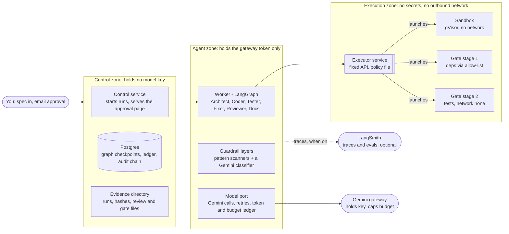
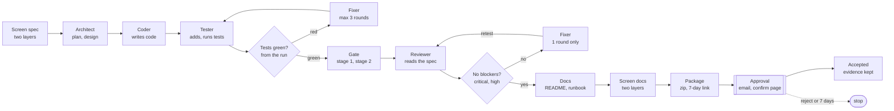

# Agent Factory 2: Gemini + LangChain family, no AWS

Oct 14, 2026 · Yuvaraj Aravindan

## 1. Straight answers first

Use Python end to end: LangGraph for the state graph, LangChain for Gemini and tools, LangSmith for traces and evals. The factory is a build-time tool, not the hosted core application, and it can still generate Java for regulated clients.

**1. Is the factory the core application? No.** It runs when you (or a client's CI) need a codebase built. The regulated production system is the code it generates, for example a Spring Boot service. The factory is development tooling: auditors ask what controls and evidence surround it, not what language it is written in. It does handle your specs and generated code, so treat those as confidential and use synthetic data only.

**2. Java still matters, but only for the output.** Regulated clients (banks, insurers, hospitals) mostly run Java in production, so a spec can ask for a Spring Boot service as its target. That choice is separate from the factory's own language: a Python factory can emit Java, Python or anything else the sandbox can build.

**3. Python is the right engine for this job.** LangGraph, LangChain and LangSmith are one vendor's family, so checkpointing, human-approval interrupts, tracing and evals are native and arrive first. You avoid the community ports and the OpenTelemetry workaround a Java factory would need.

**4. What each part of the family does here.** LangGraph runs the state graph with a Postgres checkpointer and the `interrupt` pause for approval. LangChain calls Gemini (`langchain-google-genai`), binds tools and parses structured output into Pydantic models. LangSmith records traces and runs the factory's regression evals. Gemini is the only model family.

**5. Why not Java for the factory.** Auditors ask about controls and evidence, not the build tool's language. A JVM factory would add a second stack and weaker LangSmith support for no control benefit. Every external dependency still sits behind a small interface, so the design does not depend on the language.

## 2. Goal, non-goals, and what carries over

Agent Factory 2 keeps the design rule of the AWS version, that agents never grade their own work, and swaps every AWS service for a self-hostable open-source part. Gemini is the only model family.

**Goal.** A written spec goes in; a tested, security-reviewed, human-approved codebase comes out, with a complete evidence trail per run. One command starts a run, and a run is reproducible from its stored spec, prompts and model versions.

**Non-goals.**

- Deploying the generated code. That stays a later phase, as in the AWS version.
- Running anything on AWS, or calling any non-Gemini model.
- Being the production system. The factory is build-time tooling.
- Handling real personal or health data. Specs and test data are synthetic.

**What carries over unchanged (proven in the AWS build).**

- The pipeline shape: guardrail, Architect, Coder, Tester with a bounded Fixer loop, independent gate, Reviewer with one fix round, Docs, output guardrail, package, human approval.
- Loop caps: three test-fix rounds, one build-fix attempt, one review-fix round, then stop.
- The two-stage gate: stage one may use the internet only to fetch pre-built artifacts; stage two runs the tests with no network.
- Four lessons from the real failures: quote shell commands that contain a colon and a space; classify errors by type and chain, never by message keywords; make the Reviewer read the spec, quote the code it criticises, and list spec-accepted limits as accepted; give the Fixer the full review file, not the last 1,500 characters of chat.
- Approval by email with a confirmation page, so a mail scanner cannot approve by accident.

**What is replaced.** Section 3 maps each AWS service to its replacement.

## 3. What replaces each AWS service

Every AWS role has a plain replacement: a LangGraph graph with a Postgres checkpointer for orchestration, and Docker containers for the sandbox and the gate.

| AWS version | Replacement here | Note |
| --- | --- | --- |
| Step Functions | LangGraph `StateGraph` + `langgraph-checkpoint-postgres` | Durable and resumable; loop counters live in graph state; run history in a ledger table |
| AgentCore Runtime + Strands | LangChain tool-calling agents (`langchain-google-genai`) in a worker process | The worker holds the gateway token; generated code never runs in it |
| AgentCore Code Interpreter | Sandbox container: rootless Docker with gVisor (`runsc`), `--network none` | No credentials mounted; Kata is an option if the host supports nested virtualization (check your VPS first) |
| CodeBuild stage 1 (deps) | Container with egress only through an allow-list proxy | Downloads wheels (or jars) into a volume; runs no project code |
| CodeBuild stage 2 (test) | Container with `--network none`, deps volume read-only | The result the pipeline trusts comes from here, not from a model |
| Bedrock Guardrails | Deterministic scanners (PII patterns, secret scanner) + a separate Gemini classifier node | Two independent layers; input and output screens both |
| S3 evidence | Run directory on disk + Postgres index + SHA-256 manifest | Back up with restic, as you already do for the laptop |
| SNS + Lambda approval | SMTP email + signed one-time link served by a FastAPI control service | Token is an HMAC with a 7-day expiry, stored and burned in Postgres |
| Secrets Manager | Docker secrets or sops with age | Gemini key visible to the agent worker only |
| CloudTrail | Append-only audit table with a hash chain + LangSmith traces | Chain each row to the previous row's hash |
| Terraform | Docker Compose (one file) | Add Ansible only when a second host appears |
| Gemini via vertex-gateway | Same gateway, or the Gemini API directly | Both are Gemini-only; neither is AWS |

LangSmith is the one hosted-service addition: it records traces and runs evals. Section 10 covers using it in a regulated setting, including running with tracing switched off.

## 4. Architecture

Three zones keep the model key, the control data and untrusted code apart; the only bridge into the execution zone is the executor's fixed API.



Reading it: you submit a spec to the control service, which starts the worker. The worker calls Gemini through the gateway (the only place the key lives) and asks the executor to run tools. The executor launches the sandbox and the two gate stages; none of them can see a secret or, in the case of the sandbox and stage 2, the network. When tracing is on, traces leave the worker for LangSmith; with tracing off, the run still writes its own evidence.

## 5. Why Python, and what Java is still for

Python is the engine and Java is only a possible output. Keep the factory in one language and let each spec choose the target.

| Piece | Python package | Job in the factory |
| --- | --- | --- |
| LangGraph | `langgraph`, `langgraph-checkpoint-postgres` | State graph, loop caps, durable state, `interrupt` for approval |
| LangChain | `langchain-core`, `langchain-google-genai` | Gemini chat, tool calling, structured output |
| LangSmith | `langsmith` | Tracing, datasets, evals, prompt versions |
| Pydantic | `pydantic` | Schemas for plans, findings, verdicts and config |
| FastAPI | `fastapi`, `uvicorn` | Control service and the approval page |
| Postgres driver | `psycopg` | Checkpointer, ledger, audit table |
| Tests | `pytest` | The factory's own tests, run against fake ports |

**Targets.** The spec sets the output language: `target: python-fastapi` or `target: java-springboot`. Java runs use the same sandbox and gate with a Maven or Gradle toolchain image and a factory-owned plugin set. Prove the factory on the Python target first, then add the Java target for regulated-client demos.

**Ports.** Every external dependency is a Python `Protocol`: `ModelPort`, `SandboxPort`, `GatePort`, `ApprovalPort`, `EvidencePort`, each with a fake for tests. The graph code never imports a vendor client directly, so a library change touches one adapter.

**Versions.** Pin `langgraph`, `langchain-core`, `langchain-google-genai`, `langsmith` and Python itself in a lock file, and re-read the current docs on the day you start; these packages move quickly and package names can change. Sources: [LangGraph human-in-the-loop docs](https://docs.langchain.com/oss/python/langgraph/human-in-the-loop), [LangSmith docs](https://docs.smith.langchain.com/).

## 6. The pipeline as a state graph

The graph runs left to right on the top row, right to left on the middle row, and ends at a human; no loop can run more than its cap.



Reading it: the Tester's result comes from a real test run, and a red result sends the Fixer round (cap three), which then returns to the Tester. The gate's two stages run next. The Reviewer's findings file decides the second loop: any critical or high finding gets exactly one Fixer round, then a retest and re-review, and a second failure stops the run. State carries the loop counters, so a restart resumes with the same counts.

A stop is a normal end state with its own name (`TestsFailed`, `GateFailed`, `ReviewBlocked`, `BudgetExceeded`, `Rejected`, `Expired`) and the evidence directory intact. Nothing is accepted without the approval node, and approval cannot be granted by opening a link: it needs the confirmation click.

## 7. Sandbox and the independent gate

The agent worker never touches Docker. A small executor service does, behind a fixed API, so a prompt-injected agent cannot reach the host, the network or the Gemini key.

**Three zones.**

1. Control zone: Postgres, the control service (starts runs, serves the approval page), the evidence directory.
2. Agent zone: the worker running the LangGraph graph. It holds the Gemini key and has no Docker socket, which would be root on the host.
3. Execution zone: sandbox and gate containers, started only by the executor. No secrets, no outbound network except stage 1 through an allow-list proxy.

**Executor service.** An unprivileged daemon listening on a Unix socket. Its API is `run(runId, step, image, command, limits)` plus file read, write and list scoped to that run's workspace. It rejects anything outside the allowed image list and the run's directory, and it logs every call to the audit table. This is the replacement for AgentCore Code Interpreter.

**Sandbox profile (agent commands).**

- gVisor (`runsc`) runtime, `--network none`, read-only root filesystem, a tmpfs for scratch.
- Only the run's workspace is mounted writable; no host paths, no environment variables, no cloud credentials.
- All capabilities dropped, `no-new-privileges`, CPU, memory and process limits, a wall-clock timeout per command.

**Gate stage 1: fetch dependencies.** Network allowed only through a proxy that permits the package index you choose. It downloads binary artifacts into a volume and runs none of the generated project's code. For a Python target use `pip download --only-binary=:all:`. For a Java target use a pinned, factory-owned parent POM and resolve dependencies only; Maven plugins execute code, so the plugin set is fixed by the factory, not by the generated POM.

**Gate stage 2: run the tests.** `--network none`, dependency volume read-only, output is JUnit XML. The pipeline reads the XML, never the agent's summary. Even if a dependency is hostile, it cannot send data out of this stage.

**Anti-tamper checks in the gate.** Fail the run if the test count drops against the Tester's recorded baseline, if any test is newly disabled or skipped (`@Disabled`, `pytest.skip`), or if test files changed after the Tester step without a Fixer record. This enforces "never delete or weaken a test" with code instead of a prompt.

**Optional gate extras (phase 3).** Offline secret scanning, a static-analysis rule pack run from local rules, and a dependency vulnerability scan whose database is refreshed in stage 1.

**Host note.** gVisor does not need nested virtualization, so it runs on an ordinary VPS. Kata Containers does; check for `/dev/kvm` on the host before choosing it.

## 8. Gemini usage

Use two Gemini tiers, a strong one for planning and coding and a fast one for testing, review and docs, set in one config file so a model change never touches code. Keep your vertex-gateway in front: it already holds the key, issues per-client tokens and enforces budgets.

| Role | Tier | Why |
| --- | --- | --- |
| Architect, Coder | Strong | Planning and first-pass code quality drive everything downstream |
| Fixer | Fast first, strong on the second attempt | Same escalation as the AWS build |
| Tester, Docs | Fast | Bounded, well-specified tasks |
| Reviewer | A different tier or version from the Coder | A model reviewing its own output shares its blind spots |
| Input and output classifier | Fast | Cheap screen on every run |

Model IDs live in `models.yaml`. In the AWS build the strong tier was the "Argon" model your gateway allows and the fast tier was Flash; confirm the current IDs on the day you start.

**How the model is called.**

- Structured output for every machine-read result: the plan, the review findings file with critical and high counts, the classifier verdict. Parse into Pydantic models; reject and retry on a schema miss.
- Function calling only for the executor tools (`bash`, `read_file`, `write_file`, `list_dir`), all scoped to the run workspace.
- Workspace files are the memory. Each role gets the spec, the plan and a file listing, then reads files through tools, instead of carrying a long chat.
- Temperature at 0 to 0.2. Log model ID, parameters, prompt hash and token usage for every call, so a run can be replayed and costed.

**Retries.** Classify errors by exception type and cause chain, never by message keywords: an empty message from a wrapped network error is what stopped the AWS retry from firing. Retry transient errors (429, 5xx, timeouts) with jittered backoff and honour `Retry-After`; cap attempts; on final failure report the full chain and stack trace.

**Budget and kill switch.** A per-run token ceiling enforced in the worker and a budget cap at the gateway. When either trips, the run ends as `BudgetExceeded` with its evidence intact.

**Data handling for regulated work.** Specs and test data are synthetic, so nothing regulated goes to the model. Even so, use the Vertex route when a client asks about data terms, pin a regional endpoint where the model is offered, and check Google's current terms on training use and retention before quoting them to a client. Do not assume them.

## 9. Guardrails and regulated-industry controls

Screening uses two independent layers, and the real protection is the executor's policy, not any classifier. A prompt-injection screen can be talked around; a container with no network and no credentials cannot.

**Layer A, deterministic.** Pattern and checksum scanners for card numbers, IBANs, national IDs (SSN, NHS, Aadhaar, PAN) and secrets, run on the spec going in and on generated documents and code coming out. Block on a hit.

**Layer B, a separate Gemini classifier node.** A fast-tier call with its own prompt and no tools, returning a structured verdict for prompt injection and disallowed content. It never sees the Coder's chat, only the artifact being screened.

**Treat files as untrusted too.** A file the agent reads through a tool can carry injected instructions. The executor policy, the zone split and the loop caps are what contain that.

**Control mapping.** This table shows how the factory's mechanisms line up with common regulated-industry expectations. It maps controls and evidence; it does not certify anything, and each client's framework decides what is sufficient.

| Expectation | Factory mechanism | Evidence artifact |
| --- | --- | --- |
| Segregation of duties (author, verifier, approver differ) | Coder and Reviewer on different tiers, deterministic gate, human approval | Gate JUnit XML, review file, approval row |
| Change traceability | Every run keyed by run ID; spec hash, prompt hashes, model IDs recorded | `manifest.json` per run |
| Secure development checks | Reviewer against OWASP and STRIDE, plus gate scanners | `review.md`, `review.json`, scan reports |
| Input and output screening | Two-layer guardrails | Guardrail verdict files |
| Third-party and AI provider risk | Gemini only, through the gateway, with budgets and region pinning | Gateway logs, a model register |
| Tamper-evident logging | Hash-chained audit table | Audit export with chain check |
| Least privilege and secrets handling | Three zones, no Docker socket in the worker, key only in the worker | Compose file, executor policy file |
| Human oversight | Approval with a confirmation page and expiry | Approval record with timestamp and approver |
| Data minimisation | Synthetic data only, classifier and scanners on input | Input verdict |

## 10. LangSmith, observability and evidence

Use LangSmith's native Python tracing on every run, but design the factory to work with tracing switched off, because prompts and generated code appear in traces.

**Tracing.** Set the LangSmith environment variables and LangGraph and LangChain calls are traced automatically; wrap your own functions (executor calls, gate runs, guardrail checks) with `@traceable`. Attach metadata to every trace: run ID, role, tier, model ID, spec hash and loop counters. Tag traces with the factory version so evals compare like with like.

**Confidentiality.** Traces hold prompts and generated code. Before using hosted LangSmith for a regulated client, check the data region, the options to hide or mask inputs and outputs, and whether a self-hosted deployment exists on your plan (usually an enterprise option; verify current terms). A run must still succeed, and still write its own evidence, with tracing off.

**Evals, the factory's own regression suite.** Keep three or more golden specs (start with the prior-authorisation intake API) as a LangSmith dataset. After any prompt, model or graph change, run them through the factory with LangSmith's `evaluate` and compare gate pass rate, fix rounds used, blocking review findings, tokens and wall-clock time. Block a factory release on a regression. Version the prompts in LangSmith and record the version in `manifest.json`.

**Evidence layout per run.**

```text
runs/<runId>/
  spec.md  manifest.json            # spec hash, prompt hashes, model IDs, versions
  plan/                             # architect output
  workspace/                        # the generated codebase
  steps/<n>-<role>/                 # tool-calls.jsonl, response.json, usage.json
  guardrail/in.json  out.json       # layer A and B verdicts
  gate/stage1.log  stage2/junit.xml # independent results
  review/review.md  review.json     # critical and high counts
  approval.json                     # approver, time, decision
  package.zip  SHA256SUMS
```

**Audit table.** One append-only Postgres table: run ID, timestamp, actor (service or role), action, payload hash, previous row hash, row hash. A nightly job re-verifies the chain and alerts on a break. Revoke UPDATE and DELETE for the application role.

**Retention.** Keep 30 days by default, longer when a client asks, and back the directory up with restic to a store you control.

## 11. Hosting it, and what Claude cloud can do

Use Claude cloud to build and unit-test the factory, and a VPS you control to run it. Do not assume a cloud coding session allows Docker, gVisor or unrestricted outbound network; run the probe below first and let the result decide how much integration testing happens there.

| Piece | Build and test in Claude cloud | Run on your VPS |
| --- | --- | --- |
| Python code, LangGraph graph, all ports | Yes | Yes |
| Unit tests with a fake `ModelPort` (recorded Gemini responses) | Yes | Yes |
| Checkpointer tests | Yes, with the in-memory or SQLite saver; Postgres if it can run in the session | Yes, Postgres |
| Executor, gVisor sandbox, two-stage gate | Only if the probe shows Docker works | Yes; this is the real target |
| Real Gemini calls | Avoid: never put a real key in a cloud session | Yes, via the gateway token |
| LangSmith tracing | Optional, with a throwaway key and project | Yes |
| Approval email and public link | No | Yes, behind Caddy |

**Probe (five minutes, first task in the cloud session).** Report whether each of these works: `docker info` or `podman info`; running a container with `--network none`; the `runsc` runtime; outbound access to Maven Central and to your gateway URL; how secrets are provided to the session; the maximum session length. Write the answers to `docs/environment.md` and plan from them.

**Secrets rule.** Cloud sessions get fake keys or a gateway token with a small budget cap and an expiry, never your Google credentials. Print lengths, not values, in any log.

**VPS layout.**

- One Docker Compose file: Postgres, the FastAPI control service, the worker, an allow-list egress proxy for gate stage 1.
- The executor runs as a host service under its own unprivileged user, not in Compose, so the worker's container never mounts a Docker socket.
- Caddy terminates TLS. Only the approval paths are public; everything else needs authentication.
- Size for the sandbox: at least 4 vCPU and 8 GB RAM, since builds are the heaviest step.

**Which VPS.** `contabo-tally` currently shows light load and 45% disk, but it runs TallyPrime around the clock and holds your other services. Running untrusted generated code next to them is the wrong trade; use a separate small VPS for the execution zone, or the whole factory.

**Operating it.** `factory run specs/<name>.md` starts a run and prints the run ID; `factory status <runId>` reads the ledger; `factory approve <runId>` is the command-line twin of the email link. A full AWS run took about half an hour; expect the same order of magnitude.

## 12. Build plan and repo layout

Build in six phases and stop at every gate; the security-critical executor and gate land in phase 3, before any real model traffic touches generated code at scale.

| Phase | Scope | Gate (what must be demonstrated) |
| --- | --- | --- |
| 0 Probe + skeleton | Ports, fakes, CI build, environment probe | Build is green and the environment is documented |
| 1 Graph on fakes | StateGraph, loop caps, checkpointer on Postgres | Happy path and every loop cap pass on fakes |
| 2 Real Gemini | Plan, code and review via the gateway; structured output | Prior-auth spec gives a plan and runnable code |
| 3 Executor + gate | Executor, gVisor sandbox, two-stage gate on the VPS | Canary blocked, tamper checks pass on the VPS |
| 4 Evidence + approval | Guardrails, audit chain, approval email and page | Audit chain verifies, approval works by email |
| 5 LangSmith + evals | LangSmith traces, three golden specs as evals | Baseline recorded, regression blocks release |

Reading it: phases 0 to 2 run entirely on fakes and then on Gemini, so they can happen in Claude cloud. Phase 3 needs Docker and gVisor on the VPS. Phases 4 and 5 add the evidence, approval and LangSmith layers. Each gate lists what must be demonstrated, not what was written.

```text
agent-factory/
  pyproject.toml  uv.lock          # pinned dependencies
  models.yaml  policy.yaml         # tiers; executor allow-lists and limits
  src/factory/
    graph.py  state.py  nodes/     # LangGraph graph, typed state, one module per role
    ports/  adapters/              # Protocols; Gemini, executor, SMTP, evidence
    guardrails/  gate/  evidence/  # screens, anti-tamper checks, manifest, audit chain
    control/                       # FastAPI service and approval page
    cli.py                         # factory run | status | approve
  executor/                        # unprivileged daemon that enforces policy
  specs/  prior-auth.md  templates/
  evals/golden/                    # LangSmith datasets and runners
  tests/                           # fakes, unit, graph, integration
  compose.yaml  docs/SPEC.md  docs/environment.md
```

## 13. Kickoff prompt for Claude cloud

Commit this document to the new repo as `docs/SPEC.md`, then start the cloud session with the prompt below. It makes the session probe its environment first and stop at each phase gate.

```markdown
You are building "Agent Factory 2" in this repository. The full design is in docs/SPEC.md. Read it completely before writing code.

Rules
- Stack: Python 3.12, LangGraph, LangChain (langchain-google-genai), LangSmith, Pydantic, FastAPI, Postgres, Docker Compose, pytest. Models: Gemini only. No AWS services, no other model providers.
- Pin every dependency in a lock file. Add ruff, mypy and pytest to the build.
- Every external dependency goes behind a typing.Protocol port: ModelPort, SandboxPort, GatePort, ApprovalPort, EvidencePort. Provide a fake for each so the whole graph runs in unit tests.
- Never put a real API key, Google credential or password in code, logs, tests or the session. Use fakes and recorded fixtures. Print lengths, not values. LangSmith tracing is off unless a throwaway key is supplied.
- Do not deploy anything and do not touch any external service.
- Work in phases 0 to 5 from section 12 of SPEC.md. After each phase: run the full test suite, commit on a branch, and stop with a short report: what passed, what failed, what you could not verify, and the phase's acceptance criteria with pass or fail per item.

First task (phase 0)
1. Probe this environment and write docs/environment.md: docker or podman available, a container with --network none, the runsc runtime, outbound access to PyPI and to a generic HTTPS host, how secrets are provided, maximum session length.
2. Check the current versions and package names of langgraph, langgraph-checkpoint-postgres, langchain-core, langchain-google-genai and langsmith, pin them, and report any API difference from SPEC.md.
3. Create the repo skeleton, the Protocol ports and their fakes, and a green build (pytest, ruff, mypy).
Then stop and report.
```

After each phase, review the report before saying "continue". The gates are the point: the AWS build only became reliable once each stage had a stop condition.

## 14. Risks, honest limits, open decisions

The biggest risk is believing the gate more than it deserves: it proves the tests pass, not that the tests are good, so human review of generated code stays mandatory.

| Risk | Effect | Mitigation or decision |
| --- | --- | --- |
| LangChain-family APIs and package names change quickly | Breakage on upgrade | Lock file, ports around every library, golden-spec evals before any upgrade |
| Hosted LangSmith sees prompts and generated code | Confidentiality | Region and masking checks, self-host option, a tracing-off mode |
| Coder and Reviewer are both Gemini | Shared blind spots | Different tiers, spec-aware Reviewer, deterministic gate, human approval |
| gVisor is not a hardware boundary | A kernel-level escape is less unlikely than with a microVM | Zone split, no secrets in the sandbox, dedicated VPS; move to Kata if the host allows |
| Build tools execute code (Maven or Gradle plugins for Java targets) | Stage 1 could run hostile code | Factory-owned plugin set; Python target uses wheels only; stage 1 runs no project code |
| Claude cloud may lack Docker or open network | Integration tests cannot run there | Probe first; run integration on the VPS |
| Generated code varies between runs | Same spec, different output | Log model IDs and parameters; golden-spec evals; always review output |
| Prompt injection through spec or files | Agent steered off-task | Executor policy and loop caps are the control; classifiers are a second layer |

**Not in scope yet.** Deployment of generated code, multi-tenant use, and a user interface beyond the command line and the approval page.

**Decisions for you.**

- LangSmith hosted, self-hosted, or tracing off. Default: hosted for synthetic specs, self-hosted or off for client specs.
- Explicit LangGraph nodes with tool-calling, or a ready-made agent library such as Deep Agents. Default: explicit nodes, because loop caps and approvals must be visible in the graph.
- Which VPS hosts it. Default: a new small one, not `contabo-tally`.
- First target language. Default: Python with FastAPI, then Java with Spring Boot.
- Golden specs for the eval suite. Default: prior-authorisation intake, plus two more from regulated domains you choose.
